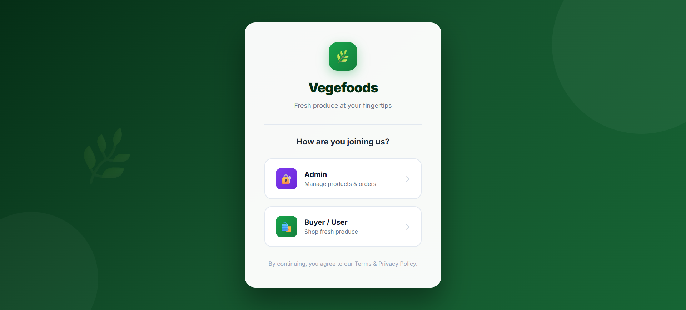
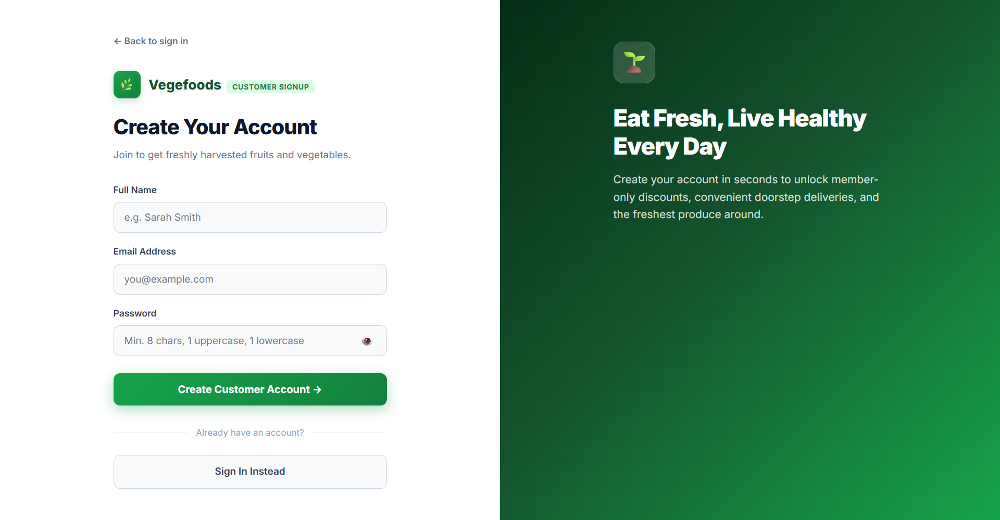
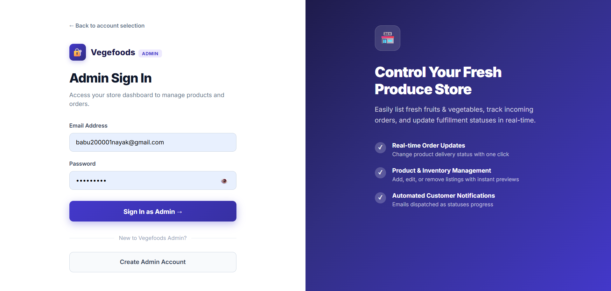
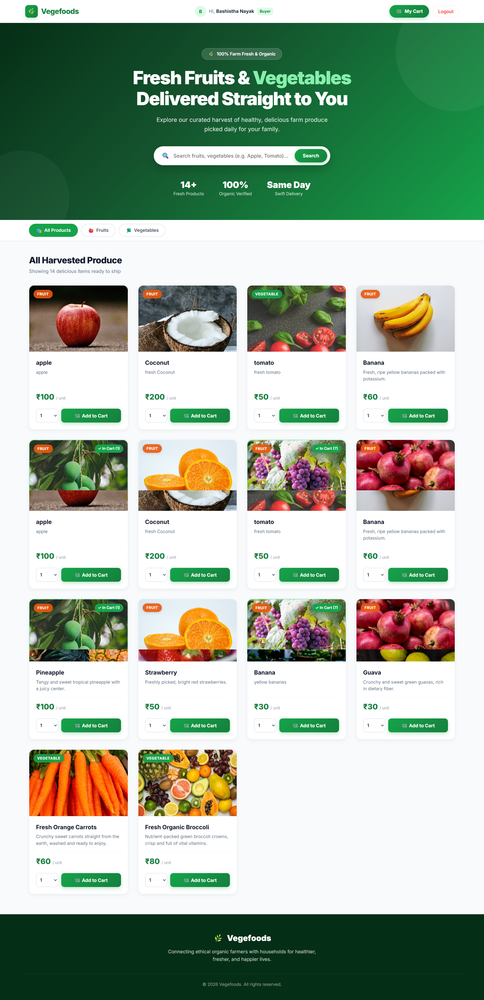
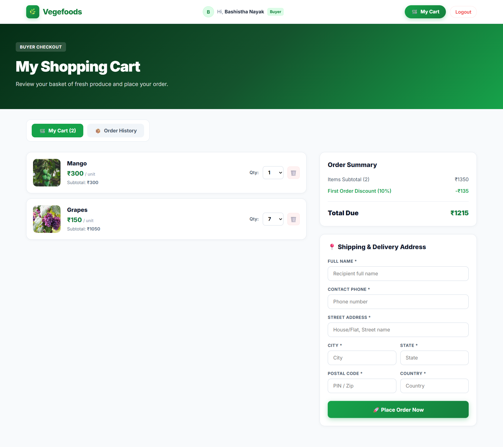
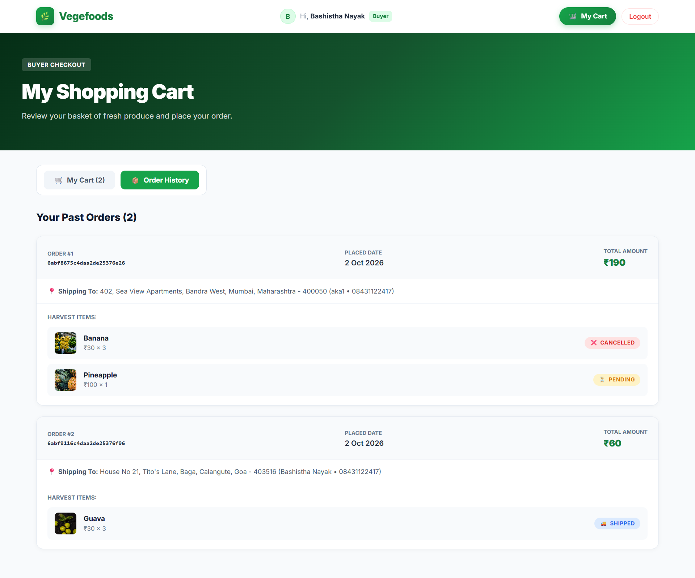
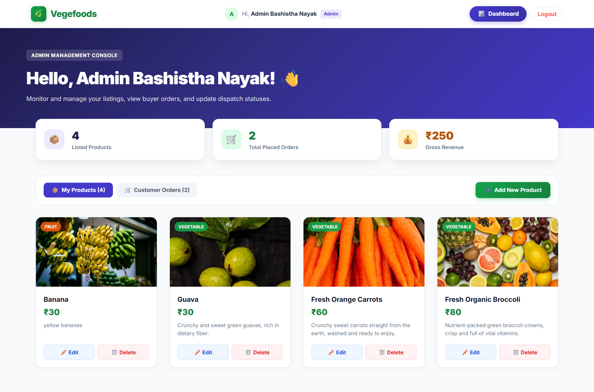
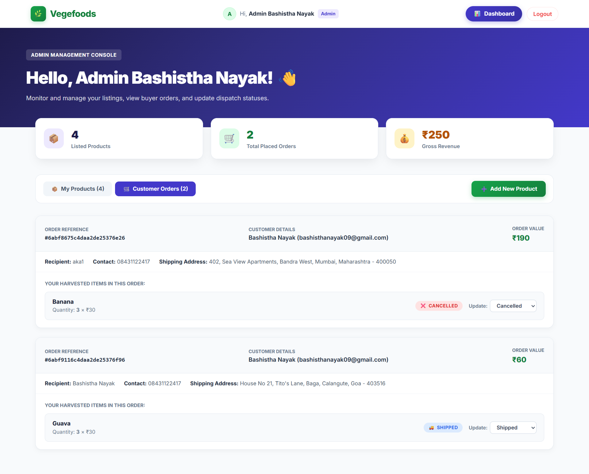
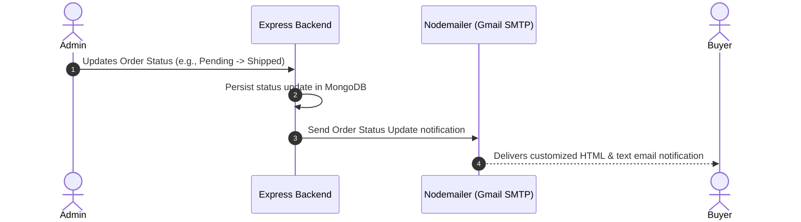

# 🌿 Vegefoods — Bulk Vegetable & Fruit Ordering Platform

[](https://fruit-ordering-platform-xjbc.vercel.app/)
[](https://reactjs.org/)
[](https://redux.js.org/)
[](https://nodejs.org/)
[](https://www.mongodb.com/)
[](LICENSE)

> A modern, responsive, full-stack **MERN** e-commerce platform designed for fresh agricultural produce, farm inventory management, and bulk customer orders with real-time email notification workflows.

---

## 🚀 Live Demo

Experience the live application deployed on Vercel:  
🔗 **[https://fruit-ordering-platform-xjbc.vercel.app/](https://fruit-ordering-platform-xjbc.vercel.app/)**

---

## 📑 Table of Contents

- [Overview](#-overview)
- [Key Features](#-key-features)
  - [Buyer Experience](#1-buyer-experience)
  - [Admin Management](#2-admin-management)
- [Screenshots & Visual Tour](#-screenshots--visual-tour)
  - [Authentication & Onboarding](#authentication--onboarding)
  - [Buyer Experience & Checkout](#buyer-experience--checkout)
  - [Admin Command Center](#admin-command-center)
- [Test Credentials](#-test-credentials)
- [Tech Stack](#-tech-stack)
- [Email Notification System](#-email-notification-system)
- [Local Installation & Setup](#-local-installation--setup)
  - [Prerequisites](#prerequisites)
  - [Step 1: Clone Repository](#step-1-clone-the-repository)
  - [Step 2: Backend Setup & Environment Variables](#step-2-backend-setup)
  - [Step 3: Frontend Setup](#step-3-frontend-setup)
- [REST API Reference](#-rest-api-reference)
- [Project Directory Structure](#-project-directory-structure)
- [Author & Credits](#-author--credits)

---

## 📖 Overview

**Vegefoods** bridges the gap between fresh produce suppliers and buyers. It allows wholesale consumers, restaurants, and individuals to browse farm-fresh fruits and vegetables, place bulk orders, track deliveries in real time, and receive instant email updates. 

Simultaneously, administrators are equipped with a dashboard to curate catalog items, modify listings, inspect incoming orders with full shipping details, and manage delivery lifecycles (`Pending` ➔ `In Progress` ➔ `Delivered`).

---

## ✨ Key Features

### 1. Buyer Experience
* **🌾 Dynamic Product Catalog:** Browse fresh harvest items with real-time search, category filtering (Fruits, Vegetables, All), and price per unit.
* **⚡ Stale-While-Revalidate Sync:** Fast page loads using Redux in-memory caching coupled with background revalidation for real-time catalog accuracy.
* **🛒 Smart Cart Integration:**
  * Auto-quantity detection: products already in the cart display current quantities and badges (`✓ In Cart (Qty)`).
  * Instant quantity adjustments and item deletion with active loading spinners.
  * Real-time automated discount calculations (10% first-order discount).
* **📍 Comprehensive Checkout:** Detailed shipping address input (name, phone, street, city, state, postal code, country).
* **📦 Live Order Tracking:** Real-time visibility into past orders with status badges (`Pending`, `In Progress`, `Delivered`, `Cancelled`).
* **📧 Automated Email Receipts:** Instant email confirmation when orders are successfully placed and dispatched.

### 2. Admin Management
* **🔐 Role-Based Access Control:** Strict JWT-based authentication separating administrator routes from buyer capabilities.
* **📊 Store Dashboard:** Overview of total products, active inventory, and placed orders.
* **🍎 Inventory Management:**
  * **Add Products:** Visual step-by-step form with live preview cards and **1-Click Quick-Fill presets** (Apples, Broccoli, Mangoes, Tomatoes, Carrots, Bananas).
  * **Edit & Update Products:** Modify descriptions, pricing, categories, and image URLs.
  * **Remove Products:** Clean deletion with automatic Redux cache invalidation.
* **🚚 Order Fulfillment:**
  * View placed orders with customer contacts and shipping destinations.
  * Line-item status controls: update individual product fulfillment statuses (`Pending`, `In Progress`, `Delivered`, `Cancelled`).
  * Triggers automated customer notification emails on every status update.

---

## 📸 Screenshots & Visual Tour

### Authentication & Onboarding

| Account Selection | Buyer Registration | Admin Sign In |
| :---: | :---: | :---: |
|  |  |  |
| *Role choice: Buyer or Store Admin* | *Secure customer registration* | *Protected admin credentials portal* |

---

### Buyer Experience & Checkout

#### 1. Marketplace (Public & Authenticated)

*Personalized fresh harvest catalog with live search, category pills, and auto-synced cart quantities.*

---

#### 2. Cart & Shipping Address Form

*Review quantities, subtotal discounts, and fill out shipping details with responsive layout.*

---

#### 3. Real-Time Order History & Tracking

*Order history with individual order cards, delivery addresses, and color-coded fulfillment statuses.*

---

### Admin Command Center

#### 1. Store Management Overview

*Central dashboard for viewing catalog listings, navigating to create products, and managing incoming orders.*

---

#### 2. Inventory & Product Control

*Manage store inventory with options to edit details or delete listings.*

---

#### 3. Customer Placed Orders & Status Management

*Inspect recipient addresses, ordered items, and trigger status updates with automated buyer email notifications.*

---

## 🔑 Test Credentials

Use these pre-configured mock credentials to test both perspectives of the platform:

| Role | Email Address | Password | Permissions |
| :--- | :--- | :--- | :--- |
| **Store Admin** | `admin1@gmail.com` | `admin1@A` | Full inventory control, order management, status updates |
| **Buyer / Customer** | `user11@gmail.com` | `user11@U` | Browse catalog, cart management, checkout, order tracking |

> [!NOTE]
> When creating your own account, passwords must be **at least 8 characters long** and contain **at least one uppercase letter and one lowercase letter**.
> To test live order emails, register a buyer account with your own valid email address.

---

## 🛠 Tech Stack

| Domain | Technology | Purpose |
| :--- | :--- | :--- |
| **Frontend UI** | React.js 18 | Declarative component architecture & Single Page Application (SPA) |
| **State Management** | Redux & Redux-Persist | In-memory catalog cache with persistent session storage |
| **Routing** | React Router v6 | Client-side routing with protected admin and buyer route guards |
| **Styling** | Modern CSS & Responsive Grids | Edge-to-edge full-bleed layouts, responsive mobile viewports |
| **Backend API** | Node.js & Express.js | RESTful API controllers, middleware, and request validation |
| **Database** | MongoDB Atlas (Mongoose 8) | Cloud NoSQL database with strict schemas and relationships |
| **Authentication** | JWT (JSON Web Tokens) & bcrypt | Cryptographic password hashing and secure token-based authentication |
| **Email Service** | Nodemailer (Gmail SMTP) | Automated transactional HTML and plain-text dispatch |
| **Hosting** | Vercel & Render | Continuous deployment for frontend and backend web services |

---

## 📬 Email Notification System

The platform includes an automated email dispatch engine powered by **Nodemailer**.



* **Event Triggers:** 
  1. An admin changes an order item's status to `Pending`, `In Progress`, `Delivered`, or `Cancelled`.
* **Payload:** Contains order ID, product name, updated status, and timestamp.
* **Delivery:** Secure SMTP transmission with customizable templates.

---

## 💻 Local Installation & Setup

### Prerequisites
* **Node.js** (v16.x or higher recommended)
* **npm** or **yarn**
* **MongoDB Atlas** account (or local MongoDB server)
* **Gmail Account** with an **App Password** (for Nodemailer notifications)

---

### Step 1: Clone the Repository
```bash
git clone https://github.com/BASHISTHANAYAK/Fruit_Ordering_Platform.git
cd Fruit_Ordering_Platform
```

---

### Step 2: Backend Setup

1. Navigate to the backend directory and install dependencies:
   ```bash
   cd backend
   npm install
   ```

2. Create your `.env` file from the provided `.env.example`:
   ```bash
   cp .env.example .env
   ```

3. Configure your environment variables in `backend/.env`:
   ```env
   # Server Port
   PORT=5000

   # MongoDB Connection String
   MONGOODB_URL=mongodb+srv://<username>:<password>@cluster0.nvzdqjx.mongodb.net/?retryWrites=true&w=majority

   # JWT Authentication Secrets
   ADMIN_JWT_SECRET_KEY=your_super_secret_admin_jwt_key
   USER_JWT_SECRET_KEY=your_super_secret_user_jwt_key

   # Nodemailer SMTP Configuration
   EMAIL_USER=your_email@gmail.com
   EMAIL_PASS=your_16_character_gmail_app_password
   ```

   > [!TIP]
   > To generate a Gmail **App Password**, go to **Google Account Settings** ➔ **Security** ➔ **2-Step Verification** ➔ **App Passwords**, generate a password for *Mail*, and paste the 16-character code into `EMAIL_PASS`.

4. Start the backend development server:
   ```bash
   npm run dev
   # Server will start on http://localhost:5000
   ```

---

### Step 3: Frontend Setup

1. Open a new terminal, navigate to the frontend directory, and install dependencies:
   ```bash
   cd frontend
   npm install
   ```

2. Launch the React development server:
   ```bash
   npm start
   # Application opens on http://localhost:3000
   ```

---

## 📡 REST API Reference

### Public Endpoints
| Method | Endpoint | Description |
| :--- | :--- | :--- |
| `GET` | `/health` | Server health check verification |
| `GET` | `/getAllProducts` | Retrieve all active produce listings |
| `POST` | `/buyerSignup` | Register a new customer account |
| `POST` | `/buyerLogin` | Authenticate customer and retrieve JWT token |
| `POST` | `/adminSignup` | Register a new administrator account |
| `POST` | `/adminLogin` | Authenticate administrator and retrieve JWT token |

### Buyer Endpoints *(Requires Buyer Token)*
| Method | Endpoint | Description |
| :--- | :--- | :--- |
| `GET` | `/getcartProducts/:buyerId` | Retrieve items currently in buyer's cart |
| `POST` | `/addToCart/:buyerId` | Add product or update item quantity in cart |
| `DELETE` | `/removeFromCart/:buyerId/:objToDeleteId` | Delete specific line item from cart |
| `POST` | `/placeOrder` | Submit bulk order with shipping details |
| `GET` | `/getOrders/:_id` | Fetch all historical orders placed by buyer |

### Admin Endpoints *(Requires Admin Token)*
| Method | Endpoint | Description |
| :--- | :--- | :--- |
| `GET` | `/getProducts/:adminId` | Get all inventory items listed by admin |
| `GET` | `/getProductById/:productId` | Retrieve details for a single product |
| `POST` | `/createProduct` | Add a new fruit/vegetable listing |
| `PUT` | `/editProduct/:productId` | Modify an existing produce listing |
| `DELETE` | `/deleteProduct/:productId` | Remove a product listing from store |
| `GET` | `/getAllPlacedOrdersByAdmin/:adminId` | View all customer orders containing admin's products |
| `PUT` | `/updateProductStatus/:orderId/:productId` | Update item fulfillment status & trigger customer email |

---

## 📂 Project Directory Structure

```text
Fruit_Ordering_Platform/
├── backend/
│   ├── controllers/          # Request handlers (Admin, Buyer, Products)
│   ├── db_connection/        # Mongoose MongoDB connection config
│   ├── middlewares/          # JWT auth middleware (adminAuth, userAuth)
│   ├── model/                # Mongoose Schemas (Admin, Buyer, Order, Product)
│   ├── Routes/               # Express API route declarations
│   ├── Utility/              # Nodemailer email utility
│   ├── .env.example          # Environment variables template
│   ├── index.js              # Server entry point
│   └── package.json
│
├── frontend/
│   ├── public/
│   │   ├── redmeImages/      # Documentation visual assets & screenshots
│   │   └── index.html        # HTML root document & global edge reset
│   ├── src/
│   │   ├── Axios_Interceptor/# Axios instance with token injection
│   │   ├── components/       # Shared UI components (NavBar, etc.)
│   │   ├── pages/            # View pages
│   │   │   ├── AdminDashboard/
│   │   │   ├── adminLogin/ & adminSignup/
│   │   │   ├── buyerLogin/ & buyerSignup/
│   │   │   ├── CartPage/
│   │   │   ├── createProductPage/
│   │   │   ├── EditProductPage/
│   │   │   ├── Homepage/
│   │   │   ├── Log-Reg-For_BuyerANDAdmin/
│   │   │   └── PageNotFound/
│   │   ├── ReduxPersist/     # Redux store, actions, and reducer
│   │   ├── Routes/           # App routes & protected route wrappers
│   │   ├── App.js
│   │   └── index.js
│   └── package.json
│
├── README.md                 # Project documentation
└── .gitignore
```

---

## 👨‍💻 Author & Credits

Developed with ❤️ by **Bashistha Nayak**

* **GitHub:** [@BASHISTHANAYAK](https://github.com/BASHISTHANAYAK)
* **Project Repository:** [Fruit_Ordering_Platform](https://github.com/BASHISTHANAYAK/Fruit_Ordering_Platform)

---

## 📄 License

This project is licensed under the [MIT License](LICENSE).
